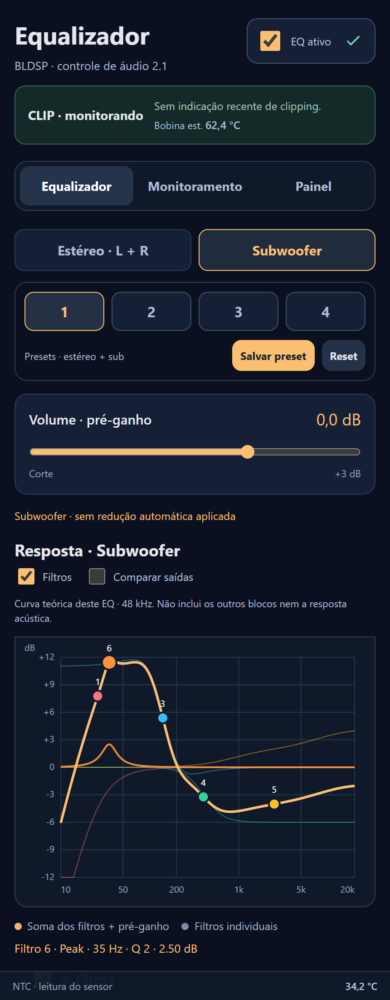
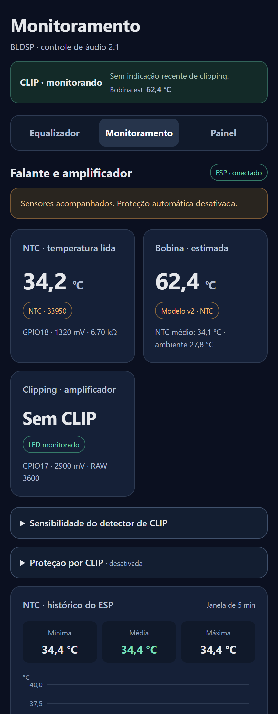
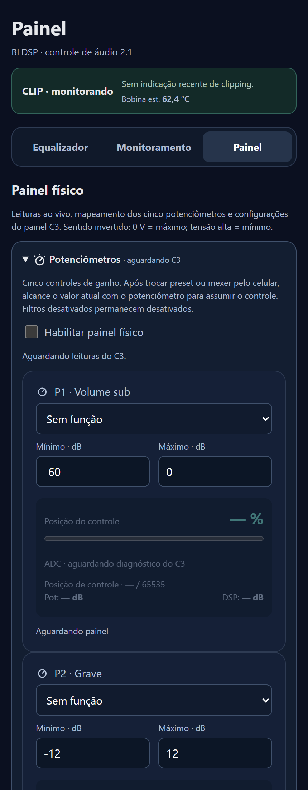

# BLDSP Control

**Controle pelo celular o equalizador de uma placa de áudio Bluetooth 2.1, sem interromper a música.**

O BLDSP Control transforma um **ESP32-S3** em uma ponte entre o navegador do celular e a placa **BL Enhance 2.1 / BP1048B2**. Você conecta o celular ao Wi-Fi do ESP e abre o portal para ajustar o subwoofer e o estéreo, visualizar a curva dos filtros e salvar presets. O áudio continua indo diretamente do celular para a BLDSP por Bluetooth.

Além da equalização, o projeto monitora temperatura e clipping e pode reduzir automaticamente o ganho do sub quando há CLIP recorrente. Um **ESP32-C3 opcional** acrescenta cinco potenciômetros físicos e uma fita LED para indicar ajustes, conexão e alertas.

```text
Celular ── Bluetooth / música ───────────────► BLDSP ──► Amplificador
   └────── Wi-Fi / portal ──► ESP32-S3 ── USB ──┘
                                ⇅ ESP-NOW
                         ESP32-C3 opcional
                         5 potenciômetros + LEDs
```

Não precisa de APK, internet ou computador durante o uso. Os presets ficam salvos no ESP32.

## Veja a interface

Capturas do próprio portal em formato de celular, geradas na prévia local com dados simulados. O painel aparece sem C3 conectado. Clique nas imagens para ampliar.

<table>
<tr><th>Equalizador</th><th>Monitoramento</th><th>Painel físico</th></tr>
<tr>
<td><a href="docs/images/equalizador-mobile.png"></a></td>
<td><a href="docs/images/monitoramento-mobile.png"></a></td>
<td><a href="docs/images/painel-mobile.png"></a></td>
</tr>
</table>

- **Equalizador:** filtros por saída, gráfico de resposta, pré-ganho e quatro presets.
- **Monitoramento:** NTC, estimativa da temperatura da bobina, histórico e proteção por CLIP.
- **Painel:** mapeamento dos potenciômetros, paletas de LED e programação do brilho por horário.

## Hardware e firmware

ESP32-S3 N16R8 com USB host, firmware ESP-IDF **5.4.x** (build validado com v5.4-dev). Placa utilizada: BL Enhance 2.1 / BP1048B2, ACP 0.0.4, efeitos 1.35.1. O painel remoto usa ESP32-C3 e comunicação ESP-NOW. Não depende de PSRAM nesta versão.

## Uso

- Música: celular → Bluetooth → BLDSP.
- Ajustes: celular → Wi-Fi do ESP32 → USB HID → BLDSP.
- Rede **BLDSP-Control**, senha inicial **equaliza123**, página **http://192.168.4.1/**. Não exige APK, internet ou CDN. Pode adicionar um atalho ao navegador. Alterar a senha em `main/app.c` antes de usar fora da bancada.
- O firmware aplica o preset 1 após inicializar/reconectar o USB. Quando o C3 conecta ou reconecta, suas posições físicas assumem os ganhos configurados; se desconectar, os ajustes permanecem. Abrir o portal apenas mostra o estado atual, sem reaplicar o preset.
- Editar valores ou ligar/desligar filtros atualiza o gráfico e enfileira a aplicação automaticamente. O envio agrupa movimentos em janelas de 40 ms, mantendo somente o ajuste mais recente de cada saída; as requisições são serializadas. Retorno antigo não sobrescreve edição mais recente. Valores incompletos/inválidos não são enviados. Falhas exibem estado de espera e tentam novamente em 1,5 s.
- Não há botões Aplicar ou Reler. Consultas internas continuam sendo usadas para confirmar o que o DSP recebeu e preservar campos desconhecidos.
- **Salvar preset** grava somente na NVS do ESP32; não grava na flash da BLDSP. Na prévia, grava no localStorage do navegador. Não há escrita NVS a cada movimento de slider.

## Interface

Evolução planejada: [roadmap de telemetria e proteção](docs/roadmap_telemetria_protecao.md), com VCC, NTCs, monitoramento no celular, isolamento USB, clipping, corrente e supervisor local de proteção. NTC, estimativa da bobina, LDR e indicação visual já estão implementados; a proteção por CLIP já é configurável no portal.

- Abas estéreo (Music Pre EQ **0x91 / aba 2**) e subwoofer (Rec Pre EQ **0x93 / aba 4**). O encaminhamento físico do estéreo ainda precisa de confirmação na bancada.
- Quatro botões de preset imediatamente abaixo das abas. Cada preset guarda as duas saídas. Trocar de preset descarta edições não salvas sem confirmação, carrega e aplica automaticamente ambos os EQs. Reset apaga o slot salvo e aplica EQ plano com pré-ganho 0 às duas saídas.
- Preset 1 provisionado uma única vez com o snapshot de 14/11, registrado em `preset1_acp.json` e `main/preset1_acp.h`. Marcador NVS `acp_seed_v1` / marcador localStorage próprio preserva saves e resets posteriores. Slot 5 antigo não é apagado, mas está fora da interface/API.
- Pré-ganho acima do gráfico: 0 dB a 667/1000 do percurso, curva não linear com mais resolução próxima de zero, zona neutra −0,3 a +0,2 dB e máximo +3 dB. Percurso negativo até −60 dB; parada inferior −128 dB rotulada Corte é atenuação por EQ, não mute físico. Extremos ainda precisam de teste na placa.
- EQ ativo no canto superior direito, com indicador único de sincronização: check ao confirmar, animação enquanto pendente e alerta em erro. Toque no ícone para detalhes. Só o gráfico fica fixo durante a rolagem. Escala vertical −12 a +12 dB, frequências de 10 Hz a 20 kHz, Fs fixa em 48 kHz para o cálculo teórico.
- Cada filtro: checkbox no título, recolhimento ao desativar, valores preservados. Quatro colunas: Tipo com ícones, Hz, Ganho, Q. Sem botão de destaque adicional.
- O slider direito começa desativado, sem parâmetro selecionado. Somente um toque explícito em Ganho (laranja) ou Q (lilás) o habilita; iniciar uma rolagem sobre o campo não seleciona nada. Selecionar outro filtro desarma o anterior; trocar de saída/preset ou desativar o filtro também desarma o slider. Q logarítmico 0,001–10, cerca de 79% do percurso até 1,5, até três casas decimais. Duplo toque em até 400 ms abre digitação; Enter também. O teclado precisa ser conferido em cada navegador móvel.
- Codificação Q10 tem passo 1/1024: Q nominal 0,001 é enviado como 1/1024. Q compacto preserva a palavra original quando não editado.
- Frequência de todos os filtros limitada a **24–20000 Hz**, incluindo slider e validação HTTP/presets. Zeros ou valores inferiores a 24 em bandas de snapshots antigos são normalizados na interface antes de enviar. O eixo começa em 10 para mostrar a atenuação abaixo do corte.
- Curvas RBJ aproximadas: https://www.w3.org/TR/audio-eq-cookbook/ . Não são medição acústica nem incluem outros blocos/crossover. Equivalência exata aos coeficientes internos do firmware não comprovada.

## Monitoramento

Mostra separadamente **NTC · temperatura lida** e **Bobina · estimada**. O observador `joint_v2` usa apenas o NTC e sua evolução, sem potência informada; média de dez amostras e filtragem reduzem oscilações. Ambiente ajustável, salvo em NVS. O estado da estrutura possui dissipação; testes incluem 72 horas de simulação e reprodução dos dois ensaios. [Modelo, erros e limitações](docs/ensaios/20261116/joint_v2/estudo_v2.md).

Aba com NTC no GPIO18 (estimativa 10 kΩ/B3950), LDR no LED CLIP no GPIO17, histórico e eventos guardados na RAM do ESP mesmo sem celular (300 amostras e 64 eventos), média/mínima/máxima e referência óptica móvel de 60 segundos. O histórico é limpo ao reiniciar o ESP. Sensores inferiores para GND e pull-ups externos de 10 kΩ para 3V3. [Montagem e limitações](docs/sensores_monitoramento.md). O detector usa referência móvel de 60 s, exclui janelas de CLIP da referência e possui parâmetros persistidos em NVS. Avisos, diagnóstico de sensor, redução automática do pré-ganho do sub e recuperação lenta são configuráveis. [Detector e parâmetros](docs/clip_configuravel.md), [lógica relativa](docs/clip_relativo.md). O observador térmico permanece informativo, sem proteção térmica automática.

## LED RGB

GPIO48, brilho limitado a 50%: arco-íris quando o controle está operacional; apagado na inicialização e por mais 3 s após os serviços (acendimento gradual em 1 s), amarelo aguardando USB, roxo trocando fonte, ciano sincronizando vermelho lento em falha e vermelho rápido em CLIP confirmado. [Estados e limites](docs/led_status.md).

## USB e persistência

Descobre interface HID para VID8888, PID171E/1719, sem fixar número da interface. Exige descritor FF00:55AA com Input/Output sem report ID de 256 bytes, versão medida e nomes dos dois módulos antes de escrever. O byte reservado 00 da API Windows não entra no payload USB. SET_REPORT(Output) e GET_REPORT(Input) usam EP0. O fluxo foi validado na bancada com a BLDSP.

Na inicialização/reconexão, aplica preset 1 a estéreo e sub e lê de volta. A terceira palavra do bloco é preservada de consulta prévia; sua semântica nesta aplicação ainda é incerta. Solicitações HTTP aguardam bootstrap USB válido. Se uma transferência ficar sem callback por três segundos, o ESP reinicia para não reutilizar DMA ativo; não envia reset/boot ao DSP.

Presets: GET/POST `/api/preset?slot=1..4`, blobs versionados na namespace NVS `eq_presets`; commit explícito somente ao salvar/resetar ou provisionar. Não há endpoint de save no DSP nem comandos FC/FD no fluxo USB atual. Capturas do save original continuam documentadas em [docs/protocolo_bp1048b2.md](docs/protocolo_bp1048b2.md) como referência histórica.

## Painel remoto C3 e automação

- [Monitoramento de alimentação](docs/bateria.md): alvo de 100 amostras/s, média/mínima a cada segundo, avisos de tensão e correlação com CLIP. [Montagem e calibração experimental do ADC2](docs/vcc_c3.md).
- Cinco potenciômetros com funções configuráveis, diagnóstico RAW/mV e estado do enlace: [painel C3](docs/painel_c3.md).
- Fita WS2812 RGB de 22 LEDs, renderização a 120 Hz, paletas, resposta aos pots e CLIP vermelho em intensidade 255. Desconectado: giro à esquerda em 8 s e respiração de 30–100% em 4 s. [Efeitos](docs/fita_ws2812.md).
- Relógio sincronizado automaticamente pelo portal e brilho por horários solares/CSV: [brilho automático](docs/brilho_automatico.md).
- Potência Wi-Fi ajustável; padrão de 2 dBm validado para eliminar interferência audível nesta montagem: [diagnóstico](docs/diagnostico_wifi.md).
- [Histórico de entregas](CHANGELOG.md). Documentos de ensaios e propostas antigas são registros históricos; os guias acima descrevem as funções atuais.

## Fluxo recomendado de desenvolvimento

Executar na raiz do repositório:

```powershell
.\tools\fw.ps1 test
.\tools\fw.ps1 deploy s3
.\tools\fw.ps1 ota
```

O último comando atualiza o C3 sem fio e restaura o S3 normal ao terminar. Logs completos ficam em `build/pipeline/`, fora do Git. [Pipeline e recuperação](docs/pipeline.md).

## Compilar

Instalar ESP-IDF **5.4.x** com alvo S3, abrir seu terminal e executar:

```powershell
cd esp32-bldsp
idf.py set-target esp32s3
idf.py build
idf.py -p COMx flash monitor
```

Usar a USB-UART para programar/depurar e reservar a USB nativa para a BLDSP. Flash 16 MB, partição factory de 3 MB, console UART. Portal cativo disponível. O C3 recebe OTA por ESP-NOW através do S3; o S3 é atualizado por USB-UART. Não exige conexão ao roteador.

## Bancada e validação pendente

1. Confirmar porta nativa GPIO19 D− / GPIO20 D+ e alimentação VBUS de 5 V. Placa com duas USB-C pode não alimentar host nem aceitar cabo C–C comum; conferir esquema/CC/adaptador antes de conectar e não unir saídas de fontes diferentes.
2. Conectar o contato de troca de fonte ao GPIO2 conforme [controle de fonte](docs/controle_fonte.md). O ESP espera USB 1719 estável, aplica pulso de 100 ms e aguarda 171E antes do preset. Se retornar ao modo USB, tenta novamente, com espera e limite de tentativas. Ligação no GPIO2 e troca automática 1719 → 171E confirmadas em teste físico em 15/11/2026.
3. Como agora a conexão aplica automaticamente o preset 1, primeiro teste deve usar volume baixo e saídas de potência controladas. Conferir EQs e continuidade da música; testar reconexão e valores extremos gradualmente.
4. Validar retenção de presets no ESP após desligar/ligar e reaplicação sem navegador aberto. Testar desconexão durante edição e falhas parciais.

Build completo e gravação no ESP32-S3 confirmados com ESP-IDF v5.4-dev instalado. USB HID, aplicação/leitura dos dois EQs, pré-ganho audível (confirmado pelo usuário) e troca automática de fonte via GPIO2 foram validados. [Registro de bancada](docs/primeiro_teste_esp32.md). Persistência e testes prolongados continuam pendentes. Nada foi gravado no firmware da BLDSP. A prévia da LAN é somente simulação.

## Ferramenta de bancada térmica

Mantida no endereço direto `http://192.168.4.1/thermal-test`, sem aba na navegação principal: média de dez leituras do NTC, previsão experimental separada, marcações da fonte e referências manuais, até 45 minutos em RAM e exportação CSV/JSON. A serial registra `THERMAL` a 1 Hz mesmo sem abrir a página. [Procedimento e API](docs/ensaio_termico.md), [estudo e previsões antes do teste de 17 V](docs/ensaios/20261116/multinode/estudo_pre17_v1.md). Sem proteção automática.

Para converter o arquivo compartilhado do PuTTY em CSV durante o teste, sem abrir a COM7 novamente:

```powershell
python tools/thermal_log_to_csv.py serial-monitor.log build/thermal-live.csv
```

## Prévia local

Requer Python 3 e usa os arquivos deste repositório, sem depender do ACP Workbench:

```powershell
python preview.py
# Para acesso pelo celular na mesma rede, use o IP LAN do computador:
python preview.py --host 192.168.2.50
```

Abra `http://127.0.0.1:8080/` no modo local ou o IP escolhido na porta 8080. A prévia simula o DSP e salva presets no navegador; não controla USB.

## Testes disponíveis

```powershell
python tests/make_fixture.py
.\tests\run_native.cmd
```

Protocolo C real contra captura binária, truncamentos, enquadramento, limites e preset inicial; script real da interface em DOM/rede/relógio simulados: boot do preset 1, envio automático para ambas as saídas, agrupamento, supressão de valores inválidos, respostas fora do estado atual, controles Q/ganho, duplo toque, presets e isolamento do save. Fórmulas de resposta testadas nos tipos de filtro e valores extremos. Inclui também reprodução C/Python dos dois ensaios térmicos, simulação longa do observador, pulsos CLIP curtos/sustentados, rejeição de lanterna lenta e recuperação de falhas de leitura. Não substituem testes de NVS/USB no dispositivo.

USB host: https://docs.espressif.com/projects/esp-idf/en/v5.4.2/esp32s3/api-reference/peripherals/usb_host.html
