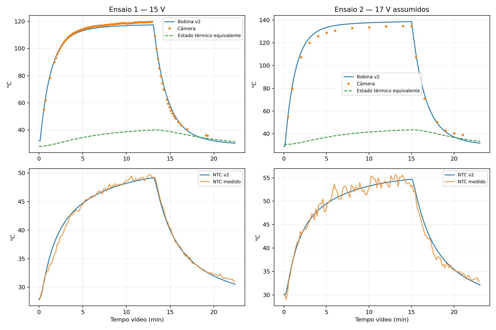
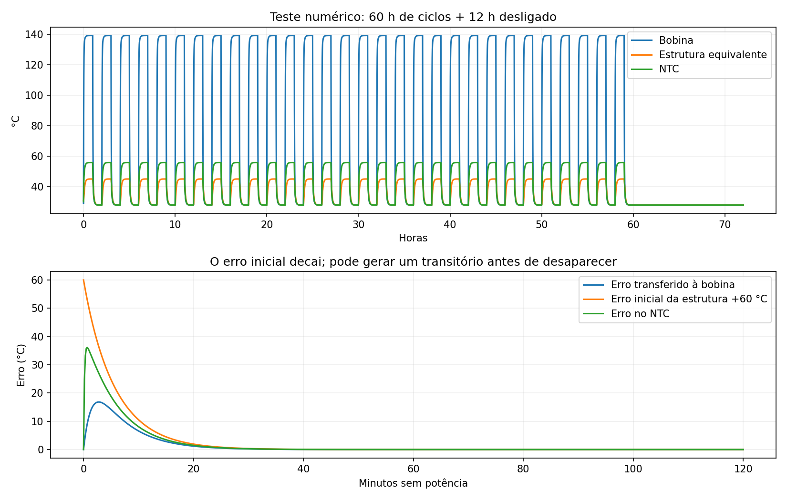
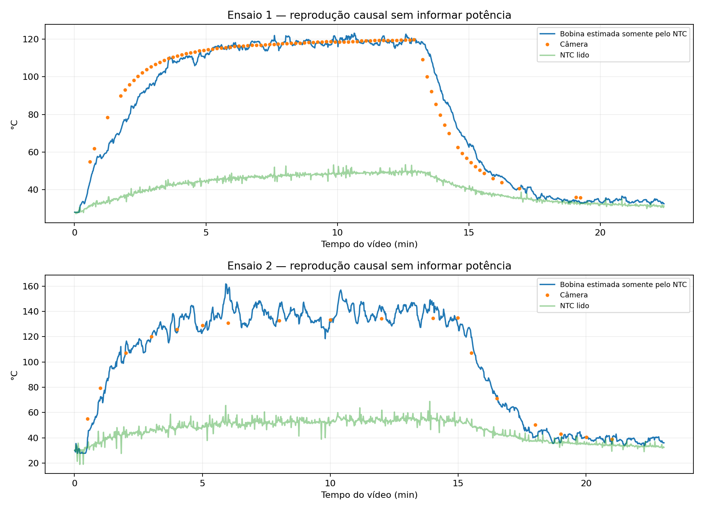

# Ajuste conjunto v2 — estabilidade antes de precisão

Os dois ensaios de 16/11/2026 foram usados para calibrar este modelo. A validação independente `pre17_v1` foi preservada. Os erros abaixo são erros de ajuste aos dados conhecidos; não são limites garantidos para outro uso.

| Ensaio | Erro médio absoluto bobina | RMS bobina | Erro médio absoluto NTC |
|---|---:|---:|---:|
| 15 V, primeiro vídeo | 1,55 °C | 1,70 °C | 0,43 °C |
| 17 V assumidos, segundo vídeo | 3,52 °C | 3,67 °C | 0,87 °C |

O segundo ensaio usa início em 8 s e desligamento inferido em ~15:01 (confirmado pelo usuário como aproximadamente 15 minutos). O salto isolado da câmera em 900,5 s continua excluído. Referências da câmera são as mesmas usadas na análise v1. NTC em janelas de aproximadamente dez amostras. A lei elétrica obtida do V/I do primeiro ensaio não foi reajustada. No segundo, 17 V continuam uma hipótese sem registro contínuo da fonte.

## Como impedir acumulação ilimitada

A estrutura é um estado com dissipação própria. Não é a integral de todo calor produzido. Com `x = Tbobina − Tambiente`, `H` a contribuição térmica equivalente da estrutura ao NTC e `n = Tntc − Tambiente`, o ajuste fornece:

```
dx/dt = Pbobina / 48.908433587 − 0.010683606408 x + 0.007553879537 H
dH/dt = 0.000315514321 x − 0.003140357862 H
dn/dt = (0.150153242935 x + H − n) / 9.761616750
```

A matriz tem três autovalores negativos: −0,102442, −0,0109873 e −0,00283663 por segundo. As constantes de tempo correspondentes são aproximadamente 9,8 s, 91 s e 353 s. O termo de perda de H impede uma memória sem decaimento. O acoplamento de volta à bobina está incluído nessa análise: não basta verificar apenas o sinal do termo de H.

Na representação física equivalente, capacidades e condutâncias são positivas. Sem potência, a energia quadrática `E = (Cc*x² + Cb*b²)/2` obedece:

```
dE/dt = −Gca*x² − Gba*b² − Gcb*(x−b)²
```

Portanto, os dois estados térmicos perdem energia até retornar ao ambiente. O NTC segue uma média ponderada estável. Com aquecimento limitado e ambiente fixo, o modelo tem temperaturas limitadas. Na lei elétrica usada, a potência também permanece limitada para estados acima do ambiente. Essa propriedade evita fuga matemática; não impede uma temperatura de equilíbrio fisicamente perigosa quando há muita potência.

A capacidade da estrutura foi fixada em 500 J/K como escolha de representação do estado oculto. Não se trata de uma medição da massa ou da temperatura real da carcaça inteira. Transformações equivalentes podem preservar as previsões com outros valores dessa capacidade. A variável H é a forma preferida para implementação.

## Verificações numéricas executadas

- Alimentações contínuas de 11, 15, 17 e 24 V por 72 h: estados finitos, convergindo ao equilíbrio. 24 V é somente um teste matemático fora dos ensaios, não uma recomendação de aplicação.
- 60 h alternando uma hora a 17 V e uma hora desligado, seguidas de 12 h desligado: nenhum crescimento ciclo após ciclo; retorno ao ambiente.
- Erro inicial deliberado de +60 °C no estado equivalente da estrutura, sem potência: após 15 min, erro transferido à bobina de 2,83 °C; após 30 min, 0,22 °C; após 60 min, 0,0013 °C. O erro da própria estrutura cai de 60 para 0,35 °C em 30 min. Pode haver um transitório de erro na bobina antes de ele desaparecer.

Os números de dissipação são propriedades deste modelo. A estrutura real pode ter constantes mais lentas não identificadas em vídeos de ~23 min. Não se interpretam essas simulações como validação física de 72 h, nem como garantia de erro máximo de 40–60 °C. Uma estimativa limitada pode continuar enviesada por ambiente incorreto, potência desconhecida, ventilação ou montagem diferente.

## Uso posterior no ESP

O firmware foi posteriormente atualizado para v2, conforme a seção de implementação abaixo. A implementação mantém os termos de dissipação, valida entradas/estados e usa integração com passo limitado. Uma lacuna longa deve invalidar a previsão em vez de integrar todo o intervalo com a última potência conhecida. Não corrigir o estado oculto acumulando indefinidamente o erro entre NTC previsto e medido; qualquer observador posterior precisa de estabilidade própria e testes com ruído/offset.

Não foi incluído um clamp para esconder divergência. O equilíbrio e o decaimento surgem das próprias equações. Não foi alterada a calibração do termistor nem habilitada proteção automática. Um próximo teste pode ficar separado para validar a v2, pois os dois existentes agora fazem parte da calibração.





Reprodução: `python fit_joint.py` e `python check_stability.py`. Bibliotecas NumPy, SciPy e Matplotlib. Resultados completos em `model_joint_v2.json` e `stability_checks.json`.

## Implementação no ESP — observador somente pelo NTC

Firmware atualizado e gravado em 16/11/2026. O modelo direto da página de ensaio usa os parâmetros joint_v2; o monitoramento normal usa um observador inverso, sem informar potência, corrente ou tensão. Os erros da tabela inicial deste estudo se referem ao modelo direto com entrada elétrica conhecida/assumida; não devem ser confundidos com a precisão deste observador.

O observador usa média móvel de dez leituras do NTC a aproximadamente 1 Hz e filtro passa-baixa de 12 s. É causal, portanto a estimativa pode atrasar mudanças rápidas. As reproduções dos registros resultaram em erro médio absoluto de 4,62 °C no primeiro ensaio e 7,64 °C no segundo, com desvios máximos nos pontos comparados de 18,96 e 25,34 °C. Os dados já participaram da calibração; esses números não são uma validação independente nem um limite de erro universal.

Para manter a memória da estrutura estável sem integrar ruído de derivada, definimos:

```
k = c / wc
lambda = d + k > 0
z = H − k*tau*n
z' = k*(1 − lambda*tau)*n − lambda*z
x = ((1 − k*tau)*n + tau*n' − z) / wc
```

`c`, `d`, `wc` e `tau` vêm das equações v2 acima; `n` é a leitura filtrada menos o ambiente. O estado z recebe atualização exponencial exata por intervalo. A derivada só entra na saída, após filtragem; não é acumulada no estado oculto. O estado é estável para NTC limitado. A bobina exibida tem piso no ambiente; valores não finitos ou acima de 500 °C ficam indisponíveis em vez de serem apresentados como leitura normal. Esse limite não habilita proteção.

Ao iniciar, a condição assumida é bobina próxima ao NTC e sensor aproximadamente estacionário; iniciar com o falante quente tem ambiguidade e exige acomodação. Não existe leitura inicial da temperatura real da estrutura. Ambiente padrão 27,8 °C, ajustável em 0–60 °C na interface, salvo em NVS. Alterar ambiente reinicia o observador. Falha de sensor ou lacuna acima de 2,5 s reinicia o estado e exige dez novas leituras. O monitoramento roda no ESP mesmo com a página fechada e não depende das marcações de ligar/desligar da página de ensaio.

API `GET /api/telemetry`: objeto `coil` contém status, celsius, ntc_mean10_c, ambient_c, samples e model=`joint_v2_ntc_observer`. `POST /api/telemetry/thermal`, com X-BLDSP:1 e JSON `{"ambient_c":27.8}`, salva o ambiente. Log serial `thermal_observer: ESTIMATE` registra média, estimativa, ambiente e validade a cada segundo.

O histórico de cinco minutos existente continua explicitamente como histórico do NTC; o cartão da bobina mostra a estimativa atual. Nenhuma ação automática modifica o ganho.

Testes nativos reproduzem ambos os arquivos de entrada e comparam a implementação C com o observador Python; incluem 72 h de leitura constante, ruído alternado, falha de sensor e recuperação de lacuna. O modelo direto foi comparado com referências SciPy recalculadas para v2. Compilação ESP-IDF e gravação com verificação de hash concluídas; logs reais confirmaram `valid=1` do observador e DSP operacional após o boot.


