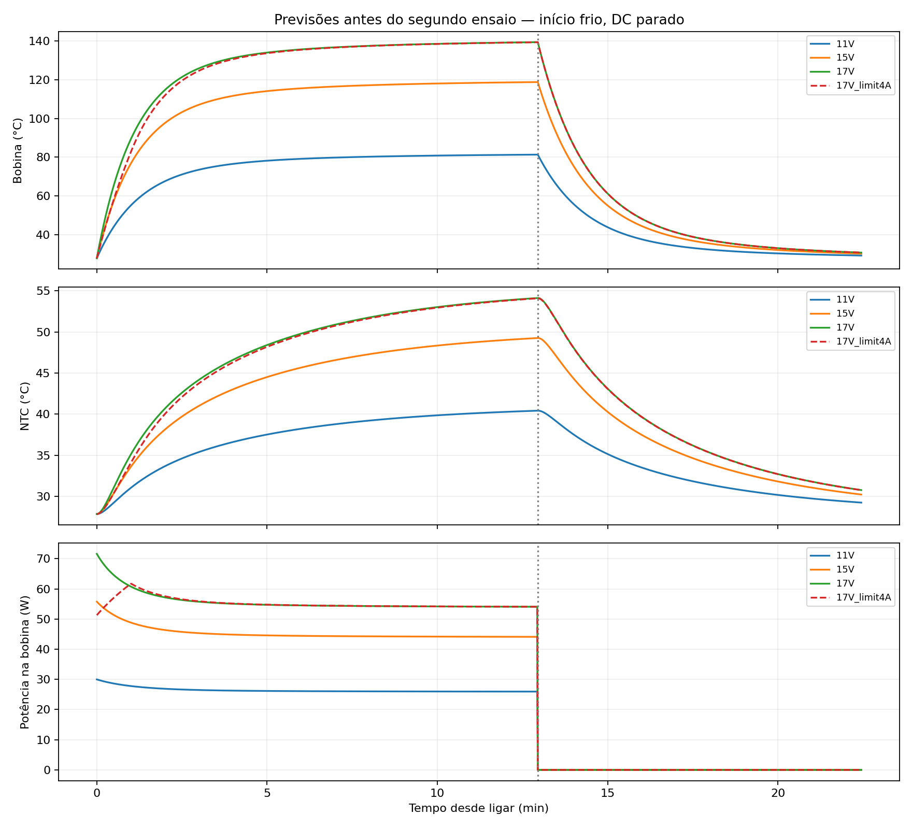

# Estudo eletrotérmico — previsão anterior ao teste de 17 V

Estudo de 16/11/2026. Dados de ajuste: somente o vídeo do ensaio de aproximadamente 15 V. A leitura do hotspot é tratada como temperatura da bobina de cobre, conforme a montagem descrita pelo usuário. O NTC está fixo aproximadamente 2 mm da bobina. A cruz branca da câmera foi excluída.

## Correção do modelo anterior

Os 86 segundos do primeiro ajuste eram uma constante efetiva de um modelo simplificado; não eram uma medição do atraso próprio do NTC. O novo estudo inclui perda de calor da bobina, calor armazenado na estrutura próxima e influência dessas duas temperaturas sobre o sensor. A permanência acima da leitura inicial é compatível com calor acumulado, mas o vídeo sozinho não separa de forma única todas as temperaturas da estrutura ou eventual mudança de ambiente.

## Resistência obtida do ensaio

Foram transcritos V e I reais da coluna direita da fonte em 20 instantes, entre 30,5 s e 784,5 s. Cada ponto está preservado em `electrical_fit_points.csv`, junto da temperatura da câmera e do cálculo R=V/I. Nenhum valor nominal de 4 Ω foi usado no ajuste. O transiente inicial, incluindo alteração/limitação de corrente, ficou fora da regressão elétrica.

A estimativa do usuário de 4 W nos fios no fim do teste implica:

```text
Rfios = 4 / 3,199² = 0,39087 Ω
Rtotal(T) = 3,59666 + 0,0118569 × (T − 27,86) Ω
Rbobina(T) = 3,20579 + 0,0118569 × (T − 27,86) Ω
           = 3,11260 × [1 + 0,00380933 × (T − 20)] Ω
I = Vfonte / [Rbobina(T) + Rfios]
Pfios = I² × Rfios
Pbobina = Vfonte × I − Pfios = I² × Rbobina(T)
```

O erro RMS da reta em relação aos pontos V/I é aproximadamente 0,010 Ω, sem incluir incertezas sistemáticas de instrumentos/sincronismo. O coeficiente a 20 °C, 0,00381/°C, é próximo do valor de referência do cobre 0,00393/°C. A resistência estimada da bobina a 20 °C é 3,11 Ω; a 27,86 °C é 3,21 Ω. A ficha JBL informa Re=3,20 Ω, mas esse valor apenas confere a ordem de grandeza.

Os 4 W são uma estimativa de perda final, não uma medição de resistência de cabos. Não se subtraíram 4 W constantes: por exemplo, o modelo prevê cerca de 8,7 W nos fios no início de 17 V e 4,7 W perto do fim. A entrada V significa tensão real na fonte com a mesma fiação, não tensão diretamente nos terminais da bobina.

## Equação linear com memória térmica

Uma forma que evita atribuir uma temperatura física única à carcaça não medida é usar H como a contribuição térmica lenta da estrutura para o NTC, em graus de contribuição ao sensor:

```text
x = Tbobina − Ta
n = Tntc − Ta
Ta = 27,86 °C, referência inicial

 dx/dt = Pbobina / 45,2895 − 0,0117125 × x + 0,00968431 × H
 dH/dt = 0,000461388 × x − 0,00397474 × H
 dn/dt = [0,128477 × x + H − n] / 13,0235

Tntc_alvo = Ta + 0,128477 × (Tbobina − Ta) + H
```

Tempo em segundos; potência em watts. A última linha é a relação linear solicitada. H cresce com o histórico de aquecimento da bobina e decai depois de desligar; por isso um único valor do NTC não corresponde sempre à mesma temperatura de bobina.

Uma realização física equivalente usa bobina, estrutura próxima e sensor:

```text
Cc dTc/dt = Pbobina − Gca(Tc−Ta) − Gcb(Tc−Tb)
Cb dTb/dt = Gcb(Tc−Tb) − Gba(Tb−Ta)
tau dTntc/dt = wc(Tc−Ta) + wb(Tb−Ta) − (Tntc−Ta)

Cc = 45,29 J/K
Cb = 519,70 J/K
Gca = 0,20615 W/K
Gcb = 0,32430 W/K
Gba = 1,74138 W/K
tau = 13,02 s
wc = 0,12848; wb = 0,73940; wambiente = 0,13213
```

Esses valores de Cb, condutâncias e pesos são **uma realização possível**, não medições separadas. Dezesseis ajustes com pontos iniciais diferentes convergiram praticamente ao mesmo erro e às mesmas saídas, mas Cb variou aproximadamente de 265 a 600 J/K e wb de 0,528 a 0,794. Isso demonstra a ambiguidade de parâmetros internos sem medir a estrutura. Os coeficientes da forma em H são muito mais estáveis.

Os 13 s também são efetivos para essa ordem de modelo. Um modelo de quatro estados, com massa global adicional, ajusta um tempo menor para o sensor; não se deve divulgar isso como constante física isolada do MF52.

## Massa do falante e carcaça

O peso total menos aproximadamente 2 kg pode servir como hipótese para a reserva térmica global:

```text
Cglobal = (Mtotal − 2 kg) × calor_específico_efetivo
```

Mas Cglobal não substitui a capacidade da estrutura local próxima da bobina: durante um ensaio curto, as peças não precisam estar todas à mesma temperatura. A massa móvel JBL de 207,5 g também não é a massa de cobre isolada.

Para incluir a hipótese de massa grande sem inventar um peso/material exato, foram ajustados modelos de quatro estados: bobina, estrutura local, conjunto global e NTC. A capacidade global foi fixada alternativamente em 4.000, 7.250 e 12.000 J/K. São cenários, não massa medida. Como exemplo de conversão, 7.250 J/K corresponderiam a 14,5 kg se o calor específico efetivo fosse assumido em 500 J/(kg K). Não foi confirmada essa combinação de massa e materiais do seu exemplar.

Os modelos com conjunto global tiveram erro RMS de aproximadamente 1,24–1,25 °C na bobina e 0,43 °C no NTC. Previram aproximadamente 139,4–139,6 °C na bobina e 53,8–53,9 °C no NTC em 17 V perto dos 13 minutos. A transferência final desse reservatório para o ambiente ficou no limite inferior do ajuste: o vídeo não determina bem seu resfriamento de longo prazo. Portanto não extrapolar esse modelo para horas de funcionamento.

## Previsões congeladas para validação

Condições: início completamente frio a 27,86 °C, mesma posição do NTC e do falante, DC parado, mesma fiação. Fonte ligada durante 777 s (12:57) e depois desligada. O tempo abaixo começa ao ligar a fonte, não ao iniciar a gravação. A tensão indicada deve ser a saída real da fonte.

| Tempo ligado | Bobina 11 V | NTC 11 V | Bobina 17 V | NTC 17 V |
|---|---:|---:|---:|---:|
| 01:00 | 55.1 °C | 31.0 °C | 89.4 °C | 35.1 °C |
| 02:00 | 67.6 °C | 33.7 °C | 114.7 °C | 40.7 °C |
| 05:00 | 78.2 °C | 37.5 °C | 134.1 °C | 48.4 °C |
| 10:00 | 80.9 °C | 39.9 °C | 138.6 °C | 53.0 °C |
| 12:56 | 81.4 °C | 40.4 °C | 139.4 °C | 54.1 °C |

Para 17 V, a previsão elétrica vai de 4,73 A / 80,4 W na fonte a aproximadamente 3,46 A / 58,7 W perto do fim. A potência na bobina vai de aproximadamente 71,6 W a 54,1 W. Em 11 V, vai de aproximadamente 30,0 W a 26,0 W na bobina.

**Limite de corrente:** se a fonte estiver limitada a 4 A, não haverá 17 V reais no início. Esse caso separado prevê saída inicial de aproximadamente 14,39 V e bobina em 82,7 °C após 60 s, contra 89,4 °C sem limitação. Perto dos 13 minutos os casos convergem. As curvas `prediction_17V_limit4A.csv` preservam essa diferença.

Após desligar o ensaio de 17 V, o modelo principal prevê aproximadamente 88 °C na bobina / 48 °C no NTC após um minuto, e 62 °C / 43 °C após dois minutos.



## Sensibilidade e alcance

O ajuste principal usa todo o primeiro ensaio, aquecimento e resfriamento. Erros RMS de ajuste: 1,30 °C na bobina e 0,50 °C no NTC. Isso ainda não é erro de previsão validado em outro ensaio.

Alterar a perda final dos fios de 4 W para 3 ou 5 W altera a previsão final de 17 V em menos de 0,2 °C neste estudo, pois o modelo térmico é reajustado ao primeiro ensaio. Alterar a hipótese de ambiente em ±2 °C durante o ajuste produz aproximadamente 137–142 °C de bobina e 51–57 °C de NTC na previsão. Esses valores são sensibilidade a hipóteses, **não intervalo estatístico de confiança**.

Os modelos de massa global adicional dão previsões próximas no horizonte de 13 minutos. Isso não prova que o modelo está correto: mudanças de convecção/radiação com temperatura, posição do sensor, fiação e estado térmico inicial podem produzir desvios. 17 V extrapola acima dos cerca de 120 °C observados no primeiro teste. A temperatura prevista não é um limite seguro do falante.

## Segundo teste

1. Preservar a montagem e deixar bobina e estrutura resfriarem antes de começar. Registrar uma linha de base sem alimentação; se o conjunto ainda estiver quente, registrar isso em vez de tratar como início frio.
2. Gravar hotspot, NTC e mostradores de tensão/corrente/potência. Registrar o instante de ligar e de desligar. Se houver limitação de corrente, manter essa informação; não é necessário alterar o limite só para coincidir com a curva ideal.
3. Uma segunda sonda na estrutura metálica próxima da bobina ajuda a separar a temperatura local da massa global. Se não for acessível, uma posição reproduzível na carcaça continua útil, desde que identificada. A cruz branca atual não será usada.
4. Comparar o novo vídeo com os CSVs congelados antes de qualquer reajuste. Trechos curtos já permitem verificar a subida inicial; não é obrigatório completar 13 minutos ou atingir a temperatura extrapolada.
5. Separar o relatório de validação do eventual ajuste v2. O estudo não habilita proteção automática nem muda a curva B3950.

## Referências e arquivos

- [JBL 15SWT5600, ficha oficial](https://www.jbl.com.br/on/demandware.static/-/Sites-masterCatalog_Harman/default/dw0ed1ab0f/pdfs/JBL_15SWT5600_28026269_manual_portuguese.pdf): Re e massa móvel; apenas referência, sem impor resistência nominal ao ajuste.
- [Kanthal C11000 ETP](https://www.kanthal.com/products/datasheets/material-datasheets/wire/conductive-wire/c11000-etp/): coeficiente de resistência do cobre e calor específico.
- [Klippel, modelo e transferência térmica](https://klippel.de/know-how/measurements/power-handling-heat-dissipation/thermal-analysis-and-heat-transfer.html): caminhos térmicos e influência de convecção.
- `model_pre17_v1.json`: parâmetros e previsões antes do segundo teste.
- `sensitivity_pre17_v1.json`: alternativas de massa, perdas e ambiente, e ambiguidade de parâmetros.
- `prediction_11V.csv`, `prediction_17V.csv`, `prediction_17V_limit4A.csv`: curvas de 1 s para comparação futura.
- `electrical_fit_points.csv`: transcrição V/I real, resistência, potência da bobina e perda nos fios.
- `../study_multinode.py`, `../sensitivity.py`: procedimentos reproduzíveis.

A massa total exata, calor específico da mistura, temperatura da carcaça e coeficiente convectivo isolado não foram medidos. Nenhum dado do futuro teste de 17 V entrou nestes ajustes.
