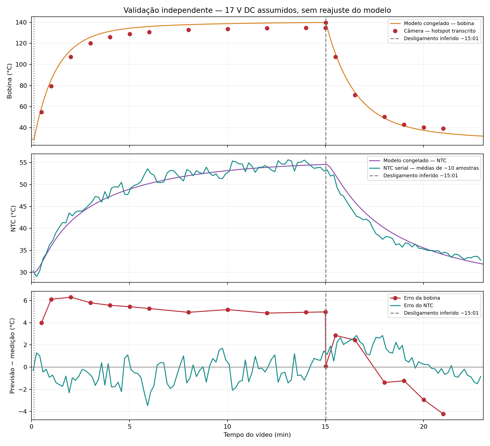

# Validação independente a 17 V — 16/11/2026

Modelo `pre17_v1`, identificado no primeiro ensaio de 15 V. Nenhum coeficiente foi reajustado com este segundo vídeo. Arquivo: `Screen_Recording_20261116_154254_Chrome.mp4`, duração 1383,0125 s.

## Alinhamento e condições

- Ambiente informado: 27,8 °C; estado inicial informado: bobina 29 °C e NTC 30 °C. O estado lento inicial é inferido supondo o NTC aproximadamente estacionário.
- Alimentação assumida: 17 V constantes, sem limite de corrente. Este vídeo não mostra a fonte: tensão, corrente e potência não foram verificadas ao longo do segundo ensaio. A observação isolada de 3,9 A não tem instante conhecido e não entra como ponto simultâneo de regressão elétrica.
- Início: ~8 s, informado pelo usuário e compatível com o aquecimento visível.
- Desligamento inferido: ~901 s (15:01), incerteza operacional estimada de ±2 s pela queda sustentada da temperatura. O comando elétrico não está visível. Isso substitui a marca verbal aproximada de 16:00 para esta comparação. Tempo energizado estimado: 893 s (14:53).
- Sincronização independente do modelo: a média NTC exibida no vídeo foi comparada com `mean10_c` dos logs. `uptime_ESP = tempo_vídeo + 275,411 s`; 1373 leituras reconhecidas, erro mediano absoluto de 0,039 °C e RMS de 0,292 °C. Atualização do navegador introduz variação temporal.
- Logs usados: boot 2. Os campos session=0/phase=idle significam ausência das marcações no front, não ausência de leitura serial.

## Tratamento das medições

O NTC foi calculado em janelas independentes de 10 segundos dos valores instantâneos do ESP, aproximadamente 10 amostras por janela. O CSV conserva a contagem e desvio padrão, sem inventar amostras faltantes. Não se aplicou nova calibração ao B3950.

As duas etiquetas vermelhas da câmera se sobrepõem em muitos quadros. A extração automática experimental produziu falsos dígitos (inclusive perda do 1 em valores acima de 100 °C); por isso NÃO foi usada nas métricas finais. Foram transcritos visualmente 19 pontos do hotspot nos quadros revisados. São referências pontuais, não médias de 10 leituras da câmera. A cruz branca não foi usada como temperatura da bobina. Uma futura extração densa deve resolver essa sobreposição antes de declarar precisão maior.

## Resultado sem reajuste

| Sinal/fase | Referências | Erro médio absoluto | Erro RMS | Viés previsão − leitura |
|---|---:|---:|---:|---:|
| Bobina, aquecimento | 12 pontos revisados | 5,29 °C | 5,32 °C | +5,29 °C |
| Bobina, resfriamento | 6 pontos revisados | 2,51 °C | 2,71 °C | −0,75 °C |
| NTC, aquecimento | 89 janelas | 0,98 °C | 1,17 °C | −0,50 °C |
| NTC, resfriamento | 48 janelas | 1,27 °C | 1,54 °C | +0,85 °C |

Em 05:00, a bobina aparece perto de 129 °C, contra 134 °C previstos. Em 14:59, aparece 134,8 °C, contra 139,8 °C previstos. Em 15:00,5 há um salto isolado para 139,7 °C; a leitura seguinte já cai. A origem desse salto não foi identificada. Esse ponto aparece no gráfico e CSV, mas foi separado das métricas de aquecimento/resfriamento para não fazer o modelo parecer mais exato por coincidência. Não há evidência para atribuí-lo a uma mudança real de potência ou a uma correção específica da câmera.

O erro da bobina chega a aproximadamente −4,2 °C no fim dos pontos revisados do resfriamento: o modelo esfria mais que a leitura. Isso é compatível com uma contribuição lenta residual ainda insuficientemente descrita, mas não identifica sozinho qual peça armazena esse calor.

## Interpretação e próximos passos

A estrutura do modelo reproduziu a forma geral e a ordem de grandeza em outro nível de alimentação. O desvio de aproximadamente +5 °C no aquecimento impede chamá-lo de medição precisa da bobina. Ele também não estabelece um limite garantido de erro para outros ensaios. A concordância do NTC não prova a identificação única das temperaturas internas.

Uma versão v2 pode ajustar conjuntamente os dois ensaios, preservando esta validação v1 como referência. Antes disso, convém confirmar a tensão efetiva na bobina/fonte e a estabilidade das leituras da câmera: erros nesses dados poderiam ser absorvidos indevidamente pelos parâmetros térmicos. Não basta subtrair 5 °C de toda a curva, pois o erro muda de sinal no resfriamento.

A previsão de 11 V continua sem validação independente. Este teste estacionário DC também não valida comportamento com música, movimento de ar, outra posição do NTC ou proteção automática. Para estimar temperatura durante áudio com potência desconhecida, ainda é necessário identificar e validar um observador a partir do NTC e/ou medir a potência efetiva.

Nenhuma alteração de firmware, curva do NTC ou proteção automática foi aplicada nesta análise.

Arquivos: `validate.py` reproduz a simulação usando `../multinode/model_pre17_v1.json`; `python align.py --ocr CAMINHO/ocr_raw.jsonl` reproduz a sincronização com os logs e o OCR local (o OCR bruto e o vídeo ficam fora do repositório). CSVs incluem referências manuais, médias do NTC, previsões e snapshot serial. `validation_metrics.json` conserva os resultados numéricos.
